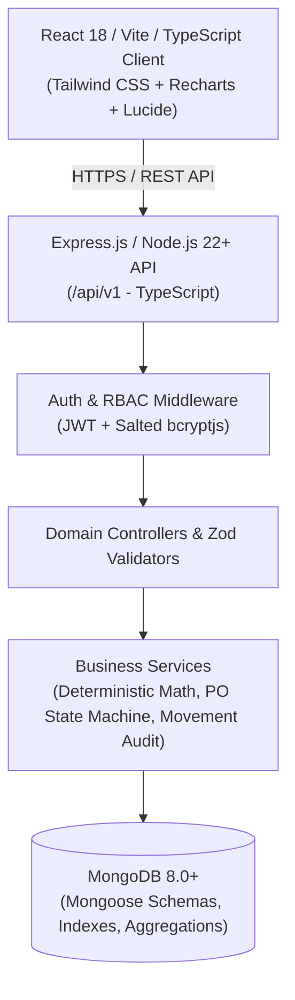

# System Architecture & Technical Design — BizFlow 360

## 1. Architectural Overview
BizFlow 360 is engineered as a modern, decoupled **MERN** (MongoDB, Express.js, React, Node.js + TypeScript) enterprise platform. It bridges transactional retail operations (purchasing, stock intake, sales allocations) with analytical intelligence (gross margins, inventory valuation, supplier SLAs, and rules-based business insights).

---

## 2. Component Layers

### 2.1 Frontend Presentation Tier
- **Framework:** React 18, Vite 6, TypeScript 5.
- **Design System:** Apple/Linear-inspired executive interface with restrained, purposeful tokens:
  - Canvas Background: `#F6F7FB`
  - Elevated Surface: `#FFFFFF`
  - Primary Typography: `#172033`
  - Secondary Typography: `#697386`
  - Primary Accent: `#5B5FEF`
  - Secondary Accent: `#16A6A1`
  - Border System: `#E7EAF0`
- **Component Primitives:** Accessible, headless-compatible components: `StatCard`, `Badge`, `Modal`, `Table`, `Select`, `Input`, `Button`, `Skeleton`, `Toast`.
- **State & Networking:** TanStack Query & native fetch client with automatic Bearer token injection and CSV formula sanitization.

### 2.2 Backend Application Tier
- **Runtime:** Node.js 22 LTS with ES2022 TypeScript (`tsx` / `tsc`).
- **Web Framework:** Express.js 4.21 with Helmet, CORS with credential support, and rate limiting.
- **Security & Authorization:**
  - Token strategy: JSON Web Tokens (JWT) signed with HMAC-SHA256.
  - Role-Based Access Control (RBAC): Enforced at route handlers for `ADMIN`, `MANAGER`, and `ANALYST`.
  - Password hashing: Salted bcrypt with work factor 10.
- **Centralized Exception Handling:** Standardized error envelopes `{ success: false, error: { code, message, details } }`.

### 2.3 Data Storage Tier
- **Database Engine:** MongoDB 8.0+ Community Server / MongoDB Atlas.
- **Object Modeling:** Mongoose 8.9 with strict typing, compound indexes, and pre-save lifecycle hooks.
- **Stock Integrity Model:**
  - Every physical stock change creates an immutable `InventoryMovement` entry storing previous stock, new stock, delta, responsible user, and business reason.
  - Purchase order receipts enforce idempotency preventing duplicate stock intake.

---

## 3. High-Performance Aggregation Pipelines
Instead of fetching all sales records into Node.js memory, BizFlow 360 executes native MongoDB aggregation pipelines:
1. **Executive Metrics Pipeline:** Aggregates eligible non-cancelled customer orders to derive Net Revenue, COGS, Gross Profit, and Gross Margin in single-pass queries.
2. **Monthly Trajectory Pipeline:** Uses `$year` and `$month` projections to return rolling 6-month revenue and profitability trends for Recharts visualization.
3. **Regional & Category Breakdown Pipeline:** Groups items across embedded line arrays and joins category metadata via `$lookup`.
