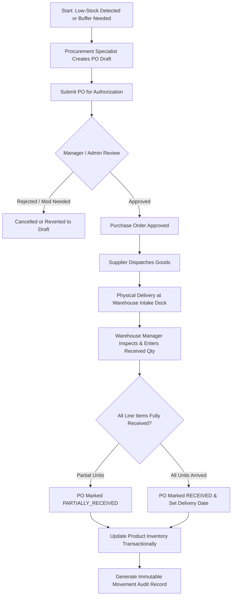
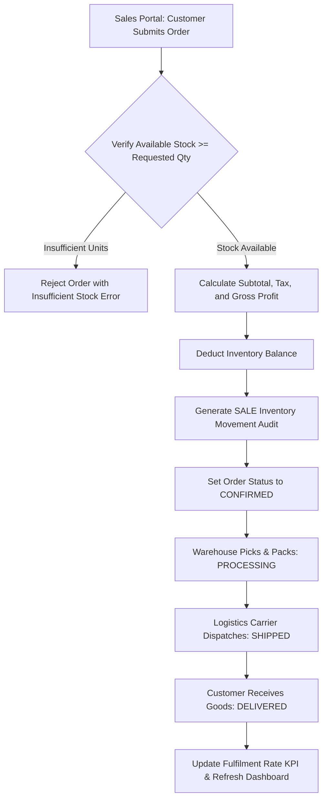
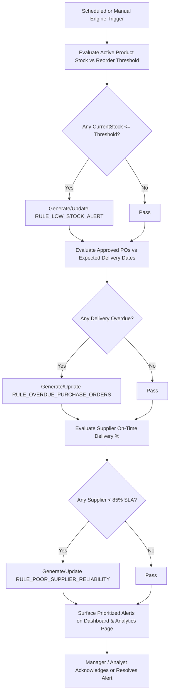

# Business Process Flows — BizFlow 360

## 1. Purchase Order Lifecycle & Stock Intake Flow

---

## 2. Customer Order Sales & Inventory Deduction Flow

---

## 3. Rules-Based Analytics & Alerting Engine Flow

